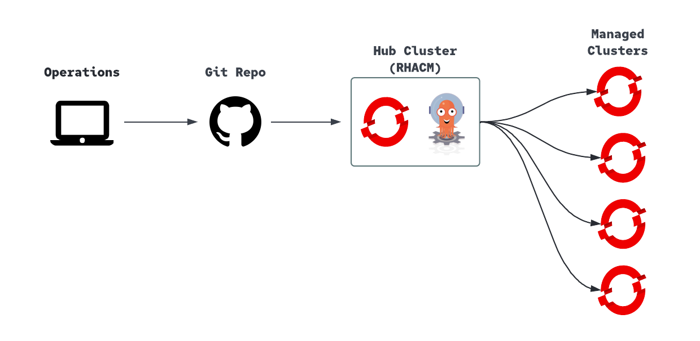

= GitOps for OpenShift4 

Last documented validation: OpenShift 4.10.18 (update this after the next verified test cycle)

NOTE: You can see an example workflow that uses this repo for GitOps link:https://github.com/r3dact3d/OCP4-Deploy/blob/main/.github/workflows/gitops.yaml[r3dact3d/OCP4-Deploy]

== Content

* <<Repo Structure, Repo Structure>>
* <<GitOps WorkFlow, GitOps WorkFlow>>
* <<Hub Cluster, Hub Cluster>>
* <<Managed Cluster Onboarding, Managed Cluster Onboarding>>
* <<Application Onboarding, Application Onboarding>>
* <<Labels, Labels>>

== Repo Structure

----
GitOps/
├─ gitops-cluster/
│  ├─ gitops-operator.yaml
│  ├─ gitopsservice.yaml
│  ├─ appset-app.yaml
│  ├─ day2-app.yaml
├─ appsets/
│  ├─ applications/
│  ├─ day2/
│  ├─ operators/
├─ manifests-cluster/
│  ├─ openshift-config/
│  ├─ openshift-monitoring/
│  ├─ openshift-ingress-operator/
│  ├─ openshift-compliance/
│  ├─ cert-manager/
├─ README.adoc
----

== GitOps WorkFlow

Bootstrap the hub cluster from resources in `gitops-cluster`, then let Argo CD sync application and operator definitions from `appsets` and cluster manifests from `manifests-cluster`.

== Hub Cluster

. Install GitOps Operator

----
oc apply -f https://raw.githubusercontent.com/r3dact3d/gitops/main/gitops-cluster/gitops-operator.yaml -n openshift-operators
oc project openshift-gitops
oc adm policy add-cluster-role-to-user cluster-admin -z openshift-gitops-argocd-application-controller
----

[start=2]
. Optional for running GitOps service on Infra nodes

----
oc apply -f https://raw.githubusercontent.com/r3dact3d/gitops/main/gitops-cluster/gitopsservice.yaml
----

== Managed Cluster Onboarding

Leverage the link:https://argocd-applicationset.readthedocs.io/en/stable/Generators-Cluster/[Cluster] Generator to onboard managed clusters by storing parameters in link:https://argo-cd.readthedocs.io/en/stable/operator-manual/declarative-setup/#clusters[secrets] 

. Create ArgoCD link:gitops-cluster/appset-app.yaml[ApplicationSet] to keep application sets synced on the hub cluster 

----
oc create -f https://raw.githubusercontent.com/r3dact3d/gitops/main/gitops-cluster/cluster-onboarding-app.yaml
----

[start=2]
. Configure cluster labels/selectors expected by ApplicationSets under link:appsets/operators/[appsets/operators] and link:appsets/day2/[appsets/day2]

== Application Onboarding

link:appsets/applications/[ApplicationSets] with cluster generator are used to manage ArgoCD applications. The strategy here is to apply all application sets to the hub cluster for the ApplicationSet controller to monitor.

In fact we can treat a git repo with applicationsets as an argoCD application as well.
    
----
oc create -f gitops-cluster/day2-app.yaml
----

link:manifests-cluster/[Cluster config] manifests logically grouped

== Labels

Kubernetes recommended link:https://kubernetes.io/docs/concepts/overview/working-with-objects/common-labels/#labels[labels].

